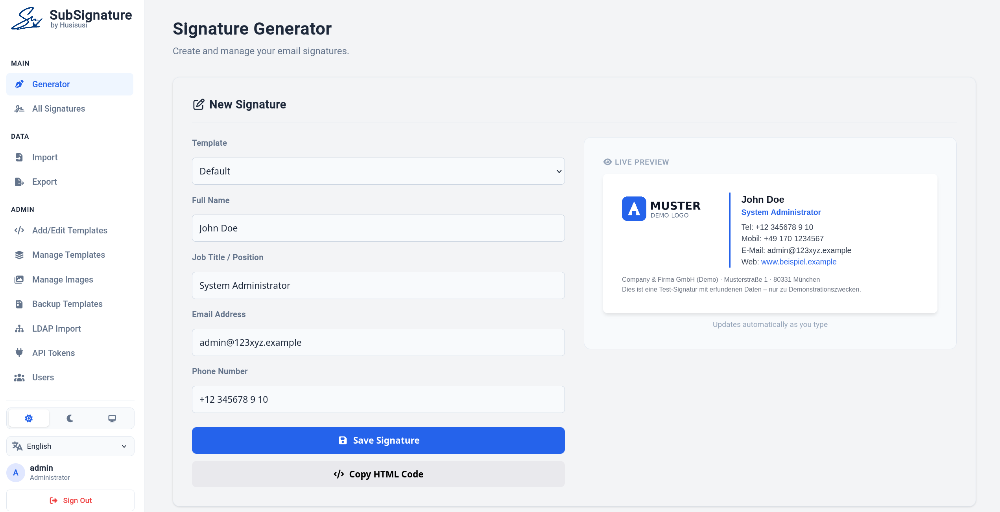
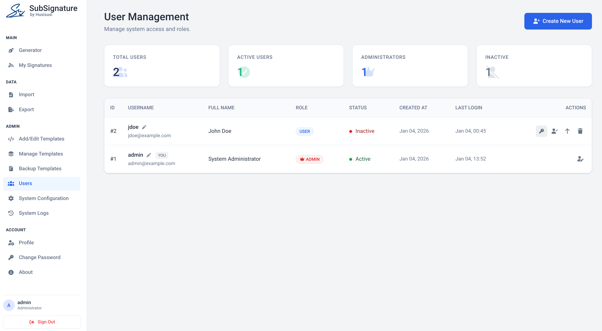
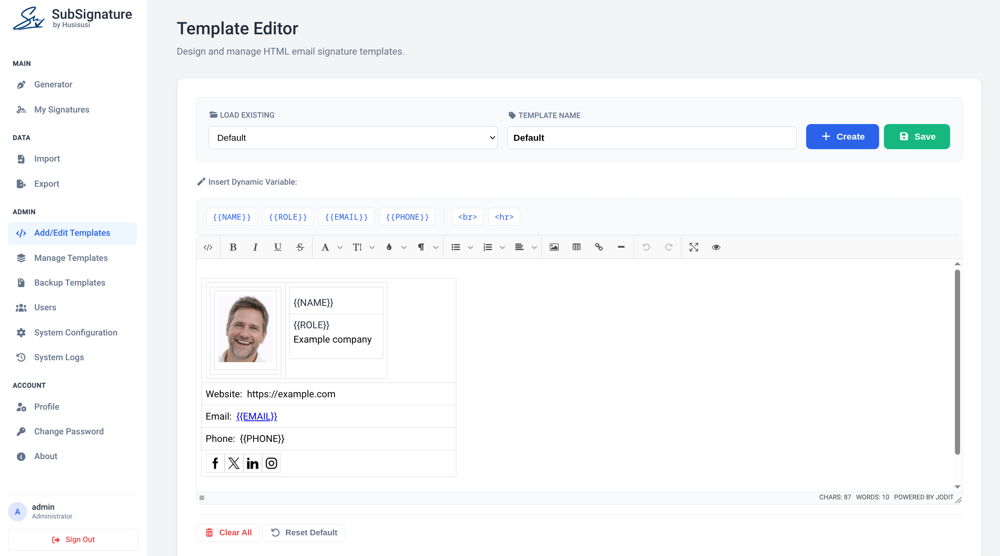
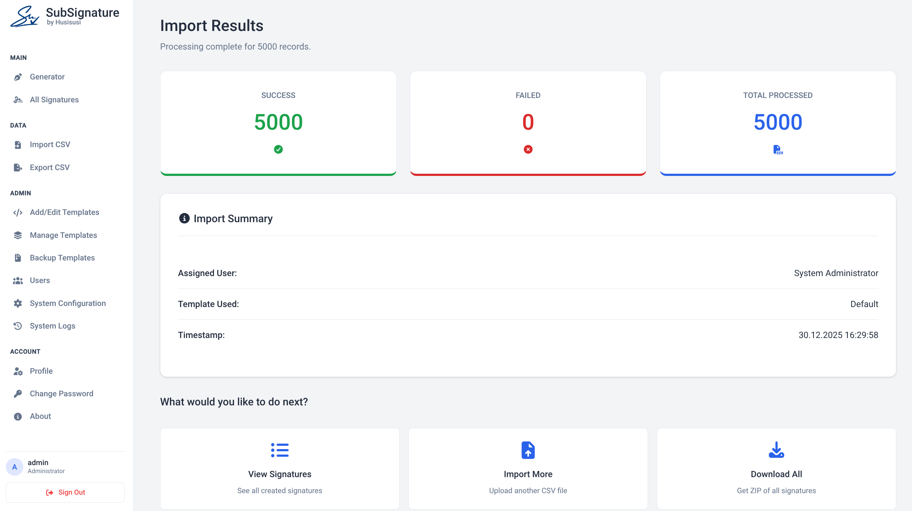

<h1>
  
  SubSignature
</h1>


SubSignature is a lightweight, self-hosted, central and free email signature management and free email signature generator built with PHP and SQLite. It helps organizations manage and standardize email signatures without complex database setups or paid cloud services.

The focus is privacy and security. The application runs entirely on your server: no CDNs, no external fonts, no telemetry. All assets are hosted locally.

## Screenshots

**Generator Interface**


**User Management**


**Template Editor**


**Import CSV**


## Features

* **Signature generator** with live preview and multiple, editable HTML templates (placeholders: `{{NAME}}`, `{{ROLE}}`, `{{EMAIL}}`, `{{PHONE}}`, `{{PHONE_CLEAN}}`).
* **Template editor** (WYSIWYG + code editor), image manager, template backup (ZIP).
* **Signature rollout:** administrators and technicians can send signatures to users by email (SMTP).
* **User management** with three roles (**administrator / technician / user**), activation, optional self-registration. See [Roles](#roles).
* **All Signatures overview** (sidebar): search, filter by user, **template**, **tag** and **source** (manual / CSV / LDAP), sort, bulk actions (delete, send, change template, add or remove tags), **inline edit** of a single signature, and a **sync-status badge** per signature: up to date or out of date, counted per device ("2/3 up to date"). See [All Signatures](#all-signatures-overview).
* **CSV import / export** of signatures (delimiter `,` or `;`, formula-injection safe export); administrators and technicians can put a **tag** on every imported signature.
* **LDAP / Active Directory import** of signatures from directory data with selection in a preview, target user and template (import only, no accounts are created, no LDAP login). See [LDAP import](#ldap--active-directory-import).
* **API with bearer tokens** for the desktop agent (Windows + Linux, already built): reads signatures for Outlook and Thunderbird, and reports back per-signature sync status. Fine-grained token scopes (`signatures:read`, `status:write`). See [API](#api-for-the-desktop-agent).
* **18 languages** (English, Deutsch, Español, Français, Italiano, Português, Nederlands, Polski, Türkçe, Русский, Українська, العربية (RTL), हिन्दी, Bahasa Indonesia, 中文, 日本語, 한국어, Bosanski): one JSON file per language in `public_html/lang/`, automatic detection from the browser, switcher in the sidebar and on the login page, per-user choice, system-wide default. See [Languages](#languages).
* **Company-wide placeholders** `{{COMPANY}}`, `{{WEBSITE}}`, `{{ADDRESS}}`, `{{DISCLAIMER}}`: maintained once in Admin -> Configuration and filled into every signature.
* **System status** panel (Admin -> Configuration): PHP version and extensions, writable directories, data directory outside the web root, secret key, installer leftovers.
* **Light, dark and system theme:** switch in the sidebar (or top right on the login page); the choice is remembered per browser, "system" follows the operating system. Signature previews always stay on white. Static files are versioned automatically (`?v=<mtime>`), so a new release shows up without clearing the browser cache.
* **Security by default:** CSRF protection, strict CSP, hardened sessions, brute-force protection, encrypted secrets, audit log. See [Security](#security).
* **Self-hosted, SQLite:** no MySQL/PostgreSQL required.

## Requirements

* PHP 7.4 or newer (tested with 8.x), with the extensions `sqlite3`, `mbstring`, `fileinfo`, `zip`, and `openssl` or `sodium`.
* Optional: the `ldap` extension for the LDAP import (`apt install php-ldap`).
* Apache 2.4 with `mod_rewrite` and `mod_headers` (the shipped `.htaccess` is written for it). Nginx works with equivalent rules, see [Hardening](#hardening-checklist).
* HTTPS (strongly recommended; required for the API).

## Installation

1. Upload the project. The recommended layout keeps `private_data/` **outside** the web root:

   ```
   /var/www/subsignature/
   ├── private_data/     <- database, secret key, logs, sessions (writable by the web server)
   └── public_html/      <- document root
   ```

   If you cannot place it outside the web root, `private_data/.htaccess` denies all access (Apache). Alternatively set the environment variable `SUBSIG_DATA_DIR` to any directory outside the web root.
2. Make `private_data/` writable by the web server user (for example `chown -R www-data: private_data && chmod 750 private_data`).
3. Open `install.php` in your browser to create the database and the first administrator. The installer locks itself as soon as an administrator exists; deleting `install.php` afterwards is still a good idea.
4. Log in and configure SMTP and options under **Configuration**.

### Optional local configuration

Copy `private_data/config.local.php.example` to `private_data/config.local.php`:

| Constant | Purpose |
|----------|---------|
| `TRUSTED_PROXIES` | IPs of reverse proxies whose `X-Forwarded-*` headers are trusted. Leave empty if there is no proxy. |
| `FORCE_HTTPS` | Redirect HTTP to HTTPS. |
| `API_ALLOW_HTTP` | Allow the API over HTTP (testing only). |
| `LOG_RETENTION_DAYS` | Retention of audit and login logs (default 180). |

### Backup

Back up the whole `private_data/` directory **including `secret.key`**. The key encrypts the SMTP and LDAP passwords stored in the database; without it these values cannot be recovered (you would have to enter them again). Keep the key and the database backups in the same secure place, never in the web root.

## LDAP / Active Directory import

**Admin → LDAP Import** creates **signatures** from directory data (name, role, email, phone) and assigns them to existing SubSignature users. It is an **import only**: **no user accounts are created** and directory users cannot log in with their directory password.

Workflow: configure → *Test connection* → *Preview* → choose entries, target user, template and an optional tag → *Import selected*. A green **Import successful** summary (created / updated / unchanged / tagged) is shown afterwards. Nothing is written before you have reviewed the preview, and the import runs in a single database transaction.

In the preview you can

* **select exactly the entries** to import (checkboxes, filter by name or email, *Select all*, *Only new and changed*, *Select none*),
* choose with a **dropdown** which SubSignature user receives the signatures: one specific user, or *Automatically by email address* (each signature goes to the active user with the same email address; entries without a matching user are skipped),
* choose the **template** the new signatures use (default: the system default template),
* optionally put a **tag** (existing or new) on every imported signature, so the batch can be found again under *All Signatures*,
* **sort the table** by clicking a column header (status, name, email, role, phone, assigned user); your selection is kept while sorting,
* optionally apply the chosen template to signatures that were imported before,
* change target or template and click *Update preview* - the directory is not queried again.

| Setting | Notes |
|---------|-------|
| Directory type | Presets for Active Directory (`sAMAccountName`, `mail`, `displayName`, `objectGUID`, `title`, `telephoneNumber`) and OpenLDAP/generic (`uid`, `mail`, `cn`, `entryUUID`). Every attribute can be changed, so any other attribute (`mobile`, `department`, `co`, ...) can be mapped. |
| Encryption | LDAPS (default, port 636) or STARTTLS. Certificates are verified by default; a private CA file can be configured. Plain LDAP is possible but not recommended. |
| Bind account | Use a **read-only** service account. Its password is stored encrypted. |
| Base DN / filter | The AD default filter excludes disabled accounts. |
| Assign signatures to | Default target in the preview (a user or *Automatically by email address*). |
| Template | Default template for new imported signatures. |

Re-import behaviour:

* Imported signatures are marked `source = ldap` and remember the directory's unique ID (or the DN if the ID attribute is empty). Importing again **updates** them instead of creating duplicates; unchanged entries are reported as *Unchanged*.
* Signatures that were created manually or by CSV import are **never modified**.
* Signatures are never deleted by the import.
* At most 5000 directory entries are read per run; a notice is shown if the result was truncated (narrow the filter or base DN).

Safety rules built into the importer:

* The target of a signature is always an existing, active user; directory data can never create users or change roles.
* Changing the server, port, encryption, certificate check, CA file or bind account requires typing the bind password again (the stored password is never carried over to another server). This also stops a technician from redirecting the service account to a server of their own.
* Names, emails and phone numbers are validated; invalid values are dropped or the entry is skipped with a reason. Duplicate directory entries (same ID or same email) are skipped.
* The preview plan is stored server side (random token, bound to the administrator, 30 minutes); the apply step re-checks everything inside a transaction.
* Paged search, referrals disabled, binary attributes are never interpreted as text.

If the PHP `ldap` extension is missing, the page shows a notice; the settings can still be edited.

## All Signatures overview

**All Signatures** (sidebar) lists signatures and combines the following filters; the state is kept in the URL, in the infinite scroll and after every action:

| Filter | Notes |
|--------|-------|
| Search | Name, email or role. |
| User | Administrators and technicians can pick one user or *All Users*; normal users only ever see their own signatures. |
| Template | Lists the templates that are actually used, with a count. A click on the template badge of a signature filters by it. |
| Tag | A tag, *All tags* or *Without tag*. |
| Source | Manual, CSV import or LDAP import (the badge on each signature is clickable too). |
| Sort | Newest / oldest first, name, email or template. |

**Tags** are coloured labels (for example `Sales`, `Management`, `To review`) that administrators and technicians create under *Manage tags* (1-32 characters, 8 colours, max. 100 tags). Select signatures, choose a tag and click *Add tag* / *Remove tag*. Normal users see the tags of their own signatures read-only. Deleting a tag removes it from all signatures; the signatures stay.

**Bulk actions** on the selected signatures: *Send*, *Delete*, *Change template* (administrators and technicians for any signature, users for their own), *Add tag* / *Remove tag* (administrators and technicians). *Delete All* removes exactly the signatures the current filter shows.

**Editing a single signature:** the pencil icon on a signature opens an edit dialog (name, role, email, phone, template; administrators and technicians can also change its tags there). Users may edit their own signatures, administrators and technicians any signature within their scope - the same ownership rule enforced everywhere else applies on the actual save, not only in the form that is shown. Editing an **LDAP-sourced** signature shows a warning that the next LDAP re-import will overwrite manual changes.

**Sync status:** each signature carries a coloured badge showing whether the desktop agents have the current version. Every agent installation (device) that applied the signature is tracked on its own:

| Badge | Meaning |
|-------|---------|
| Grey - *Never synced* | No device has reported this signature. |
| Green - *Up to date* / *2/2 up to date* | Every device has applied the current version and reported within the freshness window. |
| Yellow - *Out of date* / *1/3 up to date* | At least one device still has an older version, has not reported for a while (*No recent sync*) or reported a warning. |
| Red | At least one device reported an error applying it. |

"Current version" means the exact HTML the API serves right now: as soon as you edit a signature - or its template, or the company details - every device turns **Out of date** until its next agent run fetches and applies the new version, then it turns green again. With one device the badge names its state, with several it counts them (*2/3 up to date*).

Hover over the badge for a summary, or click it for a list of all devices with their state, last report time, agent version and message. Two settings under **Admin → Configuration**: the freshness window (default 6 hours) and after how many days a silent device is forgotten (default 30, e.g. a replaced laptop). Only agents with a token that has the `status:write` scope report - see below.

## API for the desktop agent

A **Go** agent for **Windows and Linux** (already built, see `subsignature-agent/` in the repository) fetches signatures from the server, installs them in Outlook and Thunderbird, and reports back whether each install succeeded. The server side:

* Create a token under **Admin → API Tokens** with the scopes it needs: `signatures:read` to fetch signatures, `status:write` to push sync status (a token can have either, both, or be revoked independently of others). Optional expiry, revocable, only the hash is stored.
* `GET /api/v1/signatures` returns rendered, sanitized HTML plus the raw fields, a plain-text variant and a hash for change detection; filters `username`, `email`, `updated_since`, paging.
* `POST /api/v1/status` lets the agent report per signature `ok`/`warn`/`error` plus the version it applied (`html_sha256`), per device (feeding the sync-status badge above) - a narrow write that can only store status rows, never signature content, and needs its own scope so a read-only token cannot be used to fake a status report.
* HTTPS only, rate limited (separate limits for reading and for status reports), no session or cookie involved.

Full documentation with implementation notes for the agent: [docs/API.md](docs/API.md).

## Languages

The interface language is chosen in this order: the user's saved choice (cookie / profile), the browser's `Accept-Language` header, the default language set by the administrator (Admin -> Configuration), English. Missing translations fall back to English, so a partly translated language never breaks a page. Arabic is rendered right-to-left.

Each language is a single file `public_html/lang/<code>.json` (`en`, `de`, `es`, `fr`, `it`, `pt`, `nl`, `pl`, `tr`, `ru`, `uk`, `ar`, `hi`, `id`, `zh`, `ja`, `ko` and `bs` = Bosanski). To add or improve a language see [docs/TRANSLATING.md](docs/TRANSLATING.md); a command line helper (`php tools/i18n.php`) creates, syncs and checks the files. The shipped translations are machine-quality and welcome a review by native speakers (pull requests are appreciated).

## Roles

| Area | Administrator | Technician | User |
|------|:---:|:---:|:---:|
| Generator, own signatures, own profile and password | yes | yes | yes |
| All Signatures of **all** users (filter, bulk actions, delete, change template), tags | yes | yes | own only |
| CSV import / export and ZIP download for any user | yes | yes | own only |
| Send signatures by email | yes | yes | no |
| Templates (editor, import, rename, default, delete), images, template backup | yes | yes | no |
| LDAP import (settings, preview, import) | yes | yes | no |
| API tokens | yes | yes | no |
| **Users** (create, roles, passwords, activate, delete, other profiles) | yes | **no** | no |
| **System Configuration** (SMTP, company details, security settings, status) | yes | **no** | no |
| **System Logs** (audit log, mail log) | yes | **no** | no |

* **Administrator:** everything. Creates users and assigns roles; the last active administrator can never be demoted, deactivated or deleted.
* **Technician:** runs the day-to-day tooling (templates, images, LDAP import, API tokens, rollout, all signatures) but cannot see or change users, roles, passwords, the system configuration or the logs. The role is assigned by an administrator under *Users -> Change role* or when creating a user; self-registration always creates a normal user.
* **User:** generates and manages their own signatures from the available templates, imports/exports their own data.

Rights are enforced on the server for every page and every action (not only by hiding menu entries); the role is re-read from the database on every request, so a change takes effect immediately. A technician who opens an administrator page is redirected and the attempt is written to the audit log.

## Security

An overview of the protections and the results of the security review is in [docs/SECURITY_REVIEW.md](docs/SECURITY_REVIEW.md). Highlights:

* All state-changing actions use POST with a CSRF token; no destructive GET requests.
* Strict Content-Security-Policy, `X-Frame-Options: DENY`, `nosniff`, HSTS on HTTPS; the template preview is sandboxed.
* Sessions: private session directory, `HttpOnly`, `SameSite=Strict`, `Secure` on HTTPS, ID regeneration on login, idle timeout (15 min) and absolute lifetime (8 h); role and active flag are re-checked in the database on every request; a password change signs out all other sessions.
* Login throttling per IP and per username (database backed), equalized timing for unknown users.
* Passwords hashed with bcrypt, a password policy is enforced everywhere.
* Role-based access control (administrator / technician / user) enforced server-side on every page and action; privileged areas (users, system configuration, logs) are administrator-only.
* All output is escaped; template HTML is sanitized on the server (tokenizer based, attributes are rebuilt, URL schemes are allow-listed) and in the browser.
* SMTP and LDAP passwords are encrypted at rest (libsodium or AES-GCM).
* CSV export neutralizes spreadsheet formulas; CSV import is size- and row-limited.
* Audit log of security-relevant events with retention.

### Hardening checklist

* Serve the application over HTTPS only and set `FORCE_HTTPS` if you terminate TLS yourself.
* Keep `private_data/` outside the document root.
* Run PHP with `expose_php=Off`, `display_errors=Off`, `session.use_strict_mode=1`.
* Restrict access to the admin pages by network (VPN / IP allow list) if possible.
* Give the **technician** role only to people you trust with template editing, LDAP import settings and API tokens; a technician can write templates that every user sees, and can create tokens that read all signatures.
* Use a dedicated read-only LDAP service account and LDAPS with certificate verification.
* Nginx: deny `/includes/`, `/templates/`, `/lang/`, dotfiles and `*.db|*.log|*.key`; forward the `Authorization` header (`fastcgi_param HTTP_AUTHORIZATION $http_authorization;`); route `/api/v1/*` to `api/v1/index.php`; send `Cache-Control: no-cache` for `*.css` and `*.js` (the Apache `.htaccess` does this already).
* Report vulnerabilities privately (GitHub security advisories) instead of opening a public issue.

## Credits & Third-Party Assets

* **Jodit Editor** (MIT): WYSIWYG editor for template creation.
* **Ace Editor** (BSD-3-Clause): standalone code editor written in JavaScript.
* **Font Awesome Free** (Icons CC BY 4.0, Fonts SIL OFL 1.1, Code MIT): UI icons, hosted locally.

## Roadmap

* macOS support for the desktop agent (currently Windows and Linux; see `subsignature-agent/`).
* Optional LDAP import scheduling (cron/CLI).

## Contributing

Contributions are welcome! If you find a bug, please open an issue. If you find this project useful, please give it a **star** ⭐.

## License

MIT, see [LICENSE](LICENSE).
